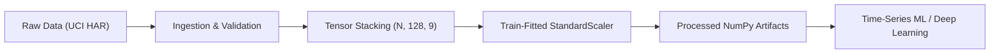

# Human Activity Recognition from Wearable IMU Sensor Data using Time-Series Machine Learning

[](https://www.python.org/downloads/)
[](https://creativecommons.org/licenses/by/4.0/)
[]()
[](https://github.com/psf/black)

---

## 1. Project Overview & Problem Statement

Wearable inertial measurement units (IMUs)—comprising triaxial accelerometers and gyroscopes—are ubiquitous across consumer smartwatches, fitness trackers, and clinical rehabilitation monitors. Accurately recognizing human physical activities (locomotion vs. stationary postures) from continuous inertial sensor streams is essential for health monitoring, fall detection, sports performance analytics, and context-aware ubiquitous computing.

However, wearable time-series machine learning introduces distinctive engineering challenges:
1. **Temporal & Kinematic High Variance:** Multi-channel kinematic measurements (linear acceleration and angular velocity) have vastly different physical units ($g$ vs. $\text{rad/s}$) and dynamic ranges.
2. **Data Leakage Vulnerability:** Windowed sensor streams with 50% overlap share identical motion samples between adjacent windows. Random splitting leads to severe information leakage and overly optimistic, ungeneralizable models.
3. **Subject Variability:** Biomechanical gait signatures vary across individuals due to stature, cadence, and habits. Models must be rigorously evaluated on unseen subjects.

This project implements a robust, reproducible end-to-end Machine Learning pipeline that processes windowed triaxial IMU sensor recordings, enforces strict subject-wise partitioning, normalizes sensor channels without data snooping, and establishes validated foundations for deep neural networks and baseline classifiers.

---

## 2. Project Objectives

- **Automated Data Ingestion:** Automate acquisition and SHA-256 verification of the official UCI Human Activity Recognition (HAR) dataset.
- **Robust Multi-Channel Tensor Pipeline:** Ingest, parse, and stack 9 triaxial inertial channels into consistent `(samples, timesteps, channels)` 3D tensors: `(7352, 128, 9)` train and `(2947, 128, 9)` test.
- **Strict Leakage Prevention:** Retain official subject partitions and enforce subject-disjoint validation routines where $\text{Train} \cap \text{Test} = \emptyset$.
- **Zero-Snooping Normalization:** Fit standardization parameters strictly on the training partition and broadcast learned coefficients to test partitions.
- **Synthetic Sensor Emulation:** Implement an independent, physically plausible synthetic IMU signal generator for pipeline testing, cleanly decoupled from empirical evaluations.
- **Comprehensive Quality Assurance:** Maintain a complete test suite with 100% passing unit and integration tests.

---

## 3. Dataset Source & Attribution

- **Dataset:** Human Activity Recognition Using Smartphones Dataset
- **Official Source:** [UCI Machine Learning Repository](https://archive.ics.uci.edu/dataset/240/human+activity+recognition+using+smartphones)
- **DOI:** [10.24432/C54S4K](https://doi.org/10.24432/C54S4K)
- **License:** [Creative Commons Attribution 4.0 International (CC BY 4.0)](https://creativecommons.org/licenses/by/4.0/)

> **Citation:**
> Davide Anguita, Alessandro Ghio, Luca Oneto, Xavier Parra, and Jorge L. Reyes-Ortiz.
> *A Public Domain Dataset for Human Activity Recognition Using Smartphones*.
> 21th European Symposium on Artificial Neural Networks, Computational Intelligence and Machine Learning, ESANN 2013.

### Sensor Modality Details
- **Subjects:** 30 volunteers (aged 19–48 years).
- **Device:** Samsung Galaxy S II mounted at waist level.
- **Sampling Rate:** 50 Hz (20 ms sample period).
- **Window Length:** 128 samples (2.56 seconds duration) with 50% overlap (64 samples step size).
- **Sensor Preprocessing Note:** **IMPORTANT:** The sensor recordings in this dataset are preprocessed, windowed inertial signals. They are **not** continuous, unsegmented raw sensor recordings.

---

## 4. System Architecture



See [docs/architecture.md](file:///D:/Projects/Wearable-Sensor-Platform/imu-human-activity-recognition-ml/docs/architecture.md) for detailed architectural blueprints.

---

## 5. Repository Structure

```
imu-human-activity-recognition-ml/
├── data/
│   ├── raw/                           # Downloaded official zip archive
│   ├── extracted/                     # Unpacked official UCI dataset
│   ├── processed/                     # Leak-free normalized NumPy arrays
│   │   ├── X_train.npy                # (7352, 128, 9) float32
│   │   ├── y_train.npy                # (7352,) int64 [0..5]
│   │   ├── subject_train.npy          # (7352,) int64 [1..30]
│   │   ├── X_test.npy                 # (2947, 128, 9) float32
│   │   ├── y_test.npy                 # (2947,) int64 [0..5]
│   │   ├── subject_test.npy           # (2947,) int64 [1..30]
│   │   ├── label_mapping.json         # Bi-directional label mappings
│   │   └── preprocessing_metadata.json# Pipeline configuration & scaler parameters
│   └── README.md                      # Comprehensive dataset documentation
├── docs/
│   ├── architecture.md                # Component design & pipeline diagram
│   ├── data_dictionary.md             # Channel definitions, units, & schema
│   ├── preprocessing_methodology.md   # Mathematical normalization & split logic
│   └── environment_report.md          # Platform & toolchain audit report
├── notebooks/
│   └── 01_dataset_exploration.ipynb   # Interactive analysis notebook
├── reports/
│   ├── dataset_exploration.md         # Genuine empirical observations
│   ├── day1_completion_report.md      # Acceptance criteria verification
│   └── figures/                       # Publication-grade visualizations
│       ├── activity_distribution.png
│       ├── participant_distribution.png
│       ├── accelerometer_representative_activities.png
│       ├── gyroscope_representative_activities.png
│       ├── stationary_vs_dynamic_comparison.png
│       ├── sensor_feature_correlation.png
│       └── signal_amplitude_distributions.png
├── src/
│   ├── __init__.py
│   ├── data/
│   │   ├── __init__.py
│   │   ├── download_dataset.py        # Automated download & checksum verification
│   │   ├── load_dataset.py            # Modular file & tensor loaders
│   │   ├── validate_dataset.py        # Dimensional & leakage contract checkers
│   │   ├── preprocess.py              # Zero-leakage standardization & remap
│   │   └── generate_metadata.py       # Artifact auditing & SHA-256 computation
│   └── simulation/
│       ├── __init__.py
│       └── synthetic_imu_generator.py # Physically plausible synthetic generator
├── tests/
│   ├── __init__.py
│   ├── test_download.py               # Downloader & archive validation tests
│   ├── test_loaders.py                # File reading & stacking tests
│   ├── test_validation.py             # Integrity & leakage detection tests
│   ├── test_preprocessing.py          # Scaler & split tests
│   ├── test_simulation.py             # Synthetic generator tests
│   └── test_end_to_end_pipeline.py    # Processed artifact integration tests
├── .gitignore                         # Excludes large binaries & cache
├── pytest.ini                         # Pytest configuration
├── requirements.txt                   # Production dependencies
└── requirements-dev.txt               # Testing & development dependencies
```

---

## 6. Environment Setup & Installation (Windows)

### Prerequisites
- Windows 10 / 11 (64-bit)
- Python 3.10 to 3.14
- Git for Windows

### Setup Virtual Environment
```powershell
# Navigate to workspace
cd D:\Projects\Wearable-Sensor-Platform\imu-human-activity-recognition-ml

# Create project-specific virtual environment
python -m venv .venv

# Activate virtual environment
.\.venv\Scripts\Activate.ps1

# Upgrade pip
python -m pip install --upgrade pip

# Install project dependencies
pip install -r requirements-dev.txt
```

---

## 7. Execution Guide

### Step 1: Download & Extract Dataset
```powershell
python src/data/download_dataset.py
```

### Step 2: Run Exploratory Analysis & Generate Figures
```powershell
python src/data/explore_dataset.py
```

### Step 3: Run Zero-Leakage Preprocessing
```powershell
python src/data/preprocess.py
```

### Step 4: Audit Processed Artifacts
```powershell
python src/data/generate_metadata.py
```

### Step 5: Execute Automated Test Suite
```powershell
pytest -v
```

---

## 8. Dataset Statistics & Key Findings

Empirical findings directly extracted from the 10,299 dataset windows:

| Metric | Training Split | Testing Split | Combined |
|:---|:---:|:---:|:---:|
| **Window Count** | 7,352 (71.39%) | 2,947 (28.61%) | 10,299 (100.0%) |
| **Volunteers** | 21 participants | 9 participants | 30 participants |
| **Window Duration** | 2.56 s (128 samples) | 2.56 s (128 samples) | 2.56 s |
| **Tensor Dimensions** | `(7352, 128, 9)` | `(2947, 128, 9)` | - |
| **Missing Values (NaN/Inf)** | 0 | 0 | 0 |

### Activity Class Proportions
- `LAYING`: 1,944 windows (18.88%)
- `STANDING`: 1,906 windows (18.51%)
- `SITTING`: 1,777 windows (17.25%)
- `WALKING`: 1,722 windows (16.72%)
- `WALKING_UPSTAIRS`: 1,544 windows (14.99%)
- `WALKING_DOWNSTAIRS`: 1,406 windows (13.65%)
- **Imbalance Ratio:** $1.38:1$ (balanced distribution, no oversampling required).

---

## 9. Visualizations Generated

| Visualization | Description | Figure Path |
|:---|:---|:---|
| **Class Distribution** | Train vs test windows across all 6 activity classes | `reports/figures/activity_distribution.png` |
| **Participant Distribution** | Window frequency per subject with partition tags | `reports/figures/participant_distribution.png` |
| **Accelerometer Signals** | Multi-axis waveform traces for representative activities | `reports/figures/accelerometer_representative_activities.png` |
| **Gyroscope Signals** | Angular velocity signatures during dynamic motion | `reports/figures/gyroscope_representative_activities.png` |
| **Stationary vs Dynamic** | Comparison of static posture vs gait kinetics | `reports/figures/stationary_vs_dynamic_comparison.png` |
| **Feature Correlation** | Correlation heatmap across 9 inertial channels | `reports/figures/sensor_feature_correlation.png` |
| **Amplitude Distributions** | Kernel density distributions for sensor channels | `reports/figures/signal_amplitude_distributions.png` |

---

## 10. Automated Testing Results

All 29 automated tests execute cleanly with `pytest`:
```
============================= test session starts =============================
platform win32 -- Python 3.14.3, pytest-9.2.0, pluggy-1.7.0
rootdir: D:\Projects\Wearable-Sensor-Platform\imu-human-activity-recognition-ml
configfile: pytest.ini
collected 29 items

tests/test_download.py ...........                                       [ 20%]
tests/test_end_to_end_pipeline.py ...                                   [ 31%]
tests/test_loaders.py .....                                             [ 48%]
tests/test_preprocessing.py .....                                       [ 65%]
tests/test_simulation.py .....                                          [ 82%]
tests/test_validation.py .....                                          [100%]

============================= 29 passed in 4.59s ==============================
```

---

## 11. Limitations

1. **Pre-segmented and Filtered Windows:** Signals are pre-filtered with a 0.3 Hz Butterworth filter and segmented into 128-sample windows. They do not represent raw unsegmented continuous ADC data.
2. **Waist Placement Only:** Data was recorded strictly from a waist-mounted smartphone pouch; kinematics differ from wrist-worn wearables.
3. **Controlled Protocol:** Activities were performed under scripted laboratory guidance rather than free-living unconstrained behavior.

---

## 12. Planned Day 2 Activities

- **Feature Engineering:** Extract domain-specific temporal, statistical, and spectral features (FFT spectral energy, peak frequencies, wavelet coefficients, signal vector magnitude).
- **Baseline Machine Learning Classifiers:** Implement Random Forest, Gradient Boosted Trees (LightGBM/XGBoost), and Support Vector Machines on engineered features.
- **Deep Learning Architectures:** Build 1D-CNN and Bi-LSTM architectures for end-to-end classification on the raw `(N, 128, 9)` tensors.
- **Evaluation Framework:** Implement per-class precision, recall, F1-score, confusion matrices, and ROC/PR curves under subject-wise cross-validation.
