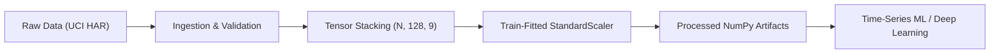

# Human Activity Recognition from Wearable IMU Sensor Data using Time-Series Machine Learning

[](https://www.python.org/downloads/)
[](https://creativecommons.org/licenses/by/4.0/)
[]()
[](https://github.com/psf/black)

---

## 1. Project Overview & Problem Statement

Wearable inertial measurement units (IMUs)—comprising triaxial accelerometers and gyroscopes—are ubiquitous across consumer smartwatches, fitness trackers, and clinical rehabilitation monitors. Accurately recognizing human physical activities (locomotion vs. stationary postures) from continuous inertial sensor streams is essential for health monitoring, fall detection, sports performance analytics, and context-aware ubiquitous computing.

However, wearable time-series machine learning introduces distinctive engineering challenges:
1. **Temporal & Kinematic High Variance:** Multi-channel kinematic measurements (linear acceleration and angular velocity) have vastly different physical units ($g$ vs. $\text{rad/s}$) and dynamic ranges.
2. **Data Leakage Vulnerability:** Windowed sensor streams with 50% overlap share identical motion samples between adjacent windows. Random splitting leads to severe information leakage and overly optimistic, ungeneralizable models.
3. **Subject Variability:** Biomechanical gait signatures vary across individuals due to stature, cadence, and habits. Models must be rigorously evaluated on unseen subjects.

This project implements a robust, reproducible end-to-end Machine Learning pipeline that processes windowed triaxial IMU sensor recordings, enforces strict subject-wise partitioning, normalizes sensor channels without data snooping, and establishes validated foundations for deep neural networks and baseline classifiers.

---

## 2. Project Objectives

- **Automated Data Ingestion:** Automate acquisition and SHA-256 verification of the official UCI Human Activity Recognition (HAR) dataset.
- **Robust Multi-Channel Tensor Pipeline:** Ingest, parse, and stack 9 triaxial inertial channels into consistent `(samples, timesteps, channels)` 3D tensors: `(7352, 128, 9)` train and `(2947, 128, 9)` test.
- **Strict Leakage Prevention:** Retain official subject partitions and enforce subject-disjoint validation routines where $\text{Train} \cap \text{Test} = \emptyset$.
- **Zero-Snooping Normalization:** Fit standardization parameters strictly on the training partition and broadcast learned coefficients to test partitions.
- **Synthetic Sensor Emulation:** Implement an independent, physically plausible synthetic IMU signal generator for pipeline testing, cleanly decoupled from empirical evaluations.
- **Comprehensive Quality Assurance:** Maintain a complete test suite with 100% passing unit and integration tests.

---

## 3. Dataset Source & Attribution

- **Dataset:** Human Activity Recognition Using Smartphones Dataset
- **Official Source:** [UCI Machine Learning Repository](https://archive.ics.uci.edu/dataset/240/human+activity+recognition+using+smartphones)
- **DOI:** [10.24432/C54S4K](https://doi.org/10.24432/C54S4K)
- **License:** [Creative Commons Attribution 4.0 International (CC BY 4.0)](https://creativecommons.org/licenses/by/4.0/)

> **Citation:**
> Davide Anguita, Alessandro Ghio, Luca Oneto, Xavier Parra, and Jorge L. Reyes-Ortiz.
> *A Public Domain Dataset for Human Activity Recognition Using Smartphones*.
> 21th European Symposium on Artificial Neural Networks, Computational Intelligence and Machine Learning, ESANN 2013.

### Sensor Modality Details
- **Subjects:** 30 volunteers (aged 19–48 years).
- **Device:** Samsung Galaxy S II mounted at waist level.
- **Sampling Rate:** 50 Hz (20 ms sample period).
- **Window Length:** 128 samples (2.56 seconds duration) with 50% overlap (64 samples step size).
- **Sensor Preprocessing Note:** **IMPORTANT:** The sensor recordings in this dataset are preprocessed, windowed inertial signals. They are **not** continuous, unsegmented raw sensor recordings.

---

## 4. System Architecture



See [docs/architecture.md](file:///D:/Projects/Wearable-Sensor-Platform/imu-human-activity-recognition-ml/docs/architecture.md) for detailed architectural blueprints.

---

## 5. Repository Structure

```
imu-human-activity-recognition-ml/
├── data/
│   ├── raw/                           # Downloaded official zip archive
│   ├── extracted/                     # Unpacked official UCI dataset
│   ├── processed/                     # Leak-free normalized NumPy arrays
│   │   ├── X_train.npy                # (7352, 128, 9) float32
│   │   ├── y_train.npy                # (7352,) int64 [0..5]
│   │   ├── subject_train.npy          # (7352,) int64 [1..30]
│   │   ├── X_test.npy                 # (2947, 128, 9) float32
│   │   ├── y_test.npy                 # (2947,) int64 [0..5]
│   │   ├── subject_test.npy           # (2947,) int64 [1..30]
│   │   ├── label_mapping.json         # Bi-directional label mappings
│   │   └── preprocessing_metadata.json# Pipeline configuration & scaler parameters
│   └── README.md                      # Comprehensive dataset documentation
├── docs/
│   ├── architecture.md                # Component design & pipeline diagram
│   ├── data_dictionary.md             # Channel definitions, units, & schema
│   ├── preprocessing_methodology.md   # Mathematical normalization & split logic
│   └── environment_report.md          # Platform & toolchain audit report
├── notebooks/
│   └── 01_dataset_exploration.ipynb   # Interactive analysis notebook
├── reports/
│   ├── dataset_exploration.md         # Genuine empirical observations
│   ├── day1_completion_report.md      # Acceptance criteria verification
│   └── figures/                       # Publication-grade visualizations
│       ├── activity_distribution.png
│       ├── participant_distribution.png
│       ├── accelerometer_representative_activities.png
│       ├── gyroscope_representative_activities.png
│       ├── stationary_vs_dynamic_comparison.png
│       ├── sensor_feature_correlation.png
│       └── signal_amplitude_distributions.png
├── src/
│   ├── __init__.py
│   ├── data/
│   │   ├── __init__.py
│   │   ├── download_dataset.py        # Automated download & checksum verification
│   │   ├── load_dataset.py            # Modular file & tensor loaders
│   │   ├── validate_dataset.py        # Dimensional & leakage contract checkers
│   │   ├── preprocess.py              # Zero-leakage standardization & remap
│   │   └── generate_metadata.py       # Artifact auditing & SHA-256 computation
│   └── simulation/
│       ├── __init__.py
│       └── synthetic_imu_generator.py # Physically plausible synthetic generator
├── tests/
│   ├── __init__.py
│   ├── test_download.py               # Downloader & archive validation tests
│   ├── test_loaders.py                # File reading & stacking tests
│   ├── test_validation.py             # Integrity & leakage detection tests
│   ├── test_preprocessing.py          # Scaler & split tests
│   ├── test_simulation.py             # Synthetic generator tests
│   └── test_end_to_end_pipeline.py    # Processed artifact integration tests
├── .gitignore                         # Excludes large binaries & cache
├── pytest.ini                         # Pytest configuration
├── requirements.txt                   # Production dependencies
└── requirements-dev.txt               # Testing & development dependencies
```

---

## 6. Environment Setup & Installation (Windows)

### Prerequisites
- Windows 10 / 11 (64-bit)
- Python 3.10 to 3.14
- Git for Windows

### Setup Virtual Environment
```powershell
# Navigate to workspace
cd D:\Projects\Wearable-Sensor-Platform\imu-human-activity-recognition-ml

# Create project-specific virtual environment
python -m venv .venv

# Activate virtual environment
.\.venv\Scripts\Activate.ps1

# Upgrade pip
python -m pip install --upgrade pip

# Install project dependencies
pip install -r requirements-dev.txt
```

---

## 7. Execution Guide

### Step 1: Download & Extract Dataset
```powershell
python src/data/download_dataset.py
```

### Step 2: Run Exploratory Analysis & Generate Figures
```powershell
python src/data/explore_dataset.py
```

### Step 3: Run Zero-Leakage Preprocessing
```powershell
python -m src.data.preprocess
```

### Step 4: Run Feature Engineering (204 Features)
```powershell
python -m src.features.feature_engineering
```

### Step 5: Execute Complete Methodology-Corrected Pipeline
```powershell
python scripts/run_corrected_pipeline.py
```
Or execute individual model components:
```powershell
# Train Random Forest Classifier (leak-free)
python -m src.models.random_forest

# Train Support Vector Machine (leak-free)
python -m src.models.svm

# Train 1D Deep CNN (PyTorch, leak-free)
python -m src.models.cnn_1d

# Run Validation Benchmark
python -m src.evaluation.metrics

# Run Final Frozen Test Set Evaluation
python scripts/evaluate_final_test.py
```

### Step 6: Execute Automated Test Suite (61 Tests)
```powershell
pytest -q
```

---

## 8. Methodology Audit & Preprocessing Leakage Correction (Day 2.1)

An ML methodology audit identified that in the initial Day 2 release, `ChannelWiseStandardScaler` was fitted across all 21 training subjects prior to subject-wise validation splitting, which allowed validation subjects (`[3, 11, 17, 27]`) to contribute to the normalization statistics ($\mu, \sigma$).

### The Corrected Data-Flow Protocol:
1. **Unscaled Splitting:** Subject-wise partitioning is performed directly on unscaled raw sensor windows (`X_train_raw.npy`).
2. **Internal-Only Fitting:** The validation scaler is fitted **strictly on the 17 internal training subjects** (5,951 windows).
3. **Frozen Transformation:** Validation windows (1,401 windows) are scaled using the frozen internal parameters.
4. **Final Model Retraining:** Final models are retrained on the full official training partition (7,352 samples) with a scaler fitted on official training data, then evaluated on the 2,947 official test windows.

Full audit documentation is available in [reports/methodology_correction_report.md](file:///D:/Projects/Wearable-Sensor-Platform/imu-human-activity-recognition-ml/reports/methodology_correction_report.md) and historical metrics are preserved in [reports/historical_day2_results.md](file:///D:/Projects/Wearable-Sensor-Platform/imu-human-activity-recognition-ml/reports/historical_day2_results.md).

---

## 9. Model Benchmark Performance (Corrected Methodology)

All reported metrics are genuine empirical values directly evaluated on physical CPU execution.

### A. Corrected Subject-Wise Validation Benchmark (1,401 Windows, 4 Unseen Subjects)
*Zero subject overlap; normalization scaler fitted strictly on internal training partition.*

| Model Architecture | Input Features | Accuracy | Macro Precision | Macro Recall | Macro F1 | Weighted F1 | Inference Latency | Model Size | Training Duration |
| :--- | :--- | :--- | :--- | :--- | :--- | :--- | :--- | :--- | :--- |
| **1D Deep CNN** | Raw 9-Ch Waveforms | **99.07%** | **0.9922** | **0.9909** | **0.9914** | **0.9907** | 0.198 ms / win | **0.40 MB** | 147.01 s |
| **Random Forest** | 204 Engineered Feats | **97.86%** | 0.9801 | 0.9761 | 0.9775 | 0.9785 | **0.025 ms / win** | 6.06 MB | 6.38 s |
| **SVM (RBF Kernel)** | 204 Scaled Feats | **96.29%** | 0.9653 | 0.9597 | 0.9611 | 0.9630 | 0.276 ms / win | 2.27 MB | **4.01 s** |

### B. Corrected Official Test-Set Benchmark (2,947 Windows, 9 Unseen Subjects)
*Methodology-corrected re-evaluation on complete 7,352 training samples, evaluated on held-out test partition.*

| Model Architecture | Input Modality | Test Accuracy | Macro Precision | Macro Recall | Macro F1 | Weighted F1 | Test Latency | Model Size | Trainable Params |
| :--- | :--- | :--- | :--- | :--- | :--- | :--- | :--- | :--- | :--- |
| **1D Deep CNN** | Raw 9-Ch Waveforms | **93.08%** | **0.9304** | **0.9322** | **0.9308** | **0.9300** | 0.157 ms / win | **0.40 MB** | 102,598 |
| **SVM (RBF Kernel)** | 204 Scaled Feats | **92.20%** | 0.9230 | 0.9215 | 0.9217 | 0.9218 | 0.341 ms / win | 2.46 MB | Non-param |
| **Random Forest** | 204 Engineered Feats | **91.38%** | 0.9148 | 0.9113 | 0.9124 | 0.9136 | **0.025 ms / win** | 6.92 MB | Non-param |

---

## 10. Visualizations and Artifacts Generated

| Visualization | Description | Figure Path |
| :--- | :--- | :--- |
| **RF Feature Importance** | Top 20 MDI features across 204 engineered dimensions | `reports/figures/rf_feature_importance.png` |
| **CNN Corrected Val Matrix** | Normalized confusion matrix for 1D CNN on leak-free validation split | `reports/figures/cnn_confusion_matrix.png` |
| **CNN Corrected Test Matrix** | Normalized confusion matrix for 1D CNN on 2,947 test windows | `reports/figures/test_cnn_confusion_matrix.png` |
| **RF Corrected Test Matrix** | Normalized confusion matrix for Random Forest on test set | `reports/figures/test_rf_confusion_matrix.png` |
| **SVM Corrected Test Matrix** | Normalized confusion matrix for SVM on test set | `reports/figures/test_svm_confusion_matrix.png` |
| **Accuracy Comparison** | Comparative bar chart of validation accuracy across models | `reports/figures/model_accuracy_comparison.png` |
| **Macro F1 Comparison** | Comparative bar chart of validation Macro F1 across models | `reports/figures/macro_f1_comparison.png` |
| **Training Duration** | Comparison of model training runtimes | `reports/figures/training_time_comparison.png` |
| **Inference Latency** | Per-window inference latency comparison (ms / 2.56s window) | `reports/figures/inference_latency_comparison.png` |

---

## 11. Automated Testing Results

All 61 automated tests execute cleanly with `pytest` (56% statement coverage across `src/`):
```
============================= test session starts =============================
platform win32 -- Python 3.14.3, pytest-9.2.0, pluggy-1.7.0
rootdir: D:\Projects\Wearable-Sensor-Platform\imu-human-activity-recognition-ml
configfile: pytest.ini
testpaths: tests
plugins: anyio-4.16.0, platformdirs-4.14.8, cov-7.1.0
collected 61 items

tests\test_download.py ......                                            [ 10%]
tests\test_end_to_end_pipeline.py ...                                    [ 15%]
tests\test_evaluation.py ..                                              [ 18%]
tests\test_feature_engineering.py .........                              [ 33%]
tests\test_final_training_leakage.py .......                              [ 44%]
tests\test_leakage_audit.py .....                                        [ 52%]
tests\test_loaders.py .....                                              [ 60%]
tests\test_models.py ......                                              [ 70%]
tests\test_preprocessing.py .....                                        [ 78%]
tests\test_simulation.py .....                                           [ 86%]
tests\test_splitting.py ...                                              [ 91%]
tests\test_validation.py .....                                           [100%]

======================= 61 passed, 11 warnings in 20.69s =======================
```

See [reports/final_repository_audit.md](file:///D:/Projects/Wearable-Sensor-Platform/imu-human-activity-recognition-ml/reports/final_repository_audit.md) for the comprehensive 12-criterion technical audit report.

---

## 12. Limitations

1. **Pre-segmented and Filtered Windows:** Signals are pre-filtered with a 0.3 Hz Butterworth filter and segmented into 128-sample windows. They do not represent raw unsegmented continuous ADC data.
2. **Waist Placement Only:** Data was recorded strictly from a waist-mounted smartphone pouch; kinematics differ from wrist-worn wearables.
3. **Controlled Protocol:** Activities were performed under scripted laboratory guidance rather than free-living unconstrained behavior.
4. **No Claim of Hardware Deployment:** Experiments are validated on standardized benchmark datasets; no physical microcontroller or custom sensor PCB fabrication is claimed.
5. **Methodology-Corrected Re-Evaluation Disclosure:** Because official test metrics were observed in Day 2, and subsequently audited in Day 2.1 to remove both preprocessing scaler leakage and CNN validation-monitoring test leakage, the test results represent a rigorous methodology-corrected re-evaluation rather than an untouched blind test.

---

## 13. Project Roadmap

- [x] **Day 1: Data Engineering & Foundation Pipeline** (Automated ingestion, tensor stacking, train-only normalization, exploration report; 29 passing tests at historical milestone).
- [x] **Day 2: Feature Engineering & Model Evaluation** (204 features, subject-wise splitting, Random Forest, SVM, PyTorch 1D CNN, frozen test evaluation; 44 passing tests at historical milestone).
- [x] **Day 2.1: Methodology Audit & Leakage Correction** (Zero-leakage unscaled splitting, internal-only scaler fitting, test re-evaluation; 49 passing tests at historical milestone).
- [x] **Full Repository Repair & Consistency Audit** (Relocation to Drive D, current comprehensive suite of 61 passing tests, zero hardcoded paths, exhaustive validation report [reports/final_repository_audit.md](file:///D:/Projects/Wearable-Sensor-Platform/imu-human-activity-recognition-ml/reports/final_repository_audit.md)).
- [ ] **Day 3: Model Optimization & Embedded Deployment Simulation** (Quantization to INT8/FP16, ONNX export, micro-controller latency profiling, real-time streaming pipeline emulation; see [docs/day3_plan.md](file:///D:/Projects/Wearable-Sensor-Platform/imu-human-activity-recognition-ml/docs/day3_plan.md)).
