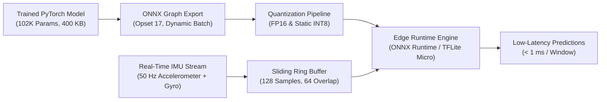
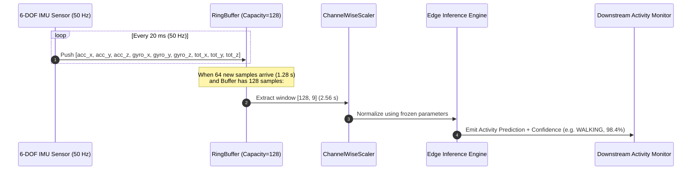

# Day 3 Implementation Plan: Edge Deployment, Model Optimization & Real-Time Streaming Emulation

**Project:** `imu-human-activity-recognition-ml`  
**Author:** Harish Narayanaan  
**Date:** November 22, 2026  
**Document Status:** Architecture & Implementation Specification (Future Roadmap)

> [!IMPORTANT]
> **Technical Scope Disclosure:**
> This document specifies the planned technical architecture, mathematical optimizations, and software interfaces for Day 3. The models and pipelines described herein are designed for future implementation and edge benchmarking; physical deployment on embedded hardware (e.g., ESP32, ARM Cortex-M) has not yet been executed.

---

## 1. Executive Vision

Day 1 established the data engineering, exploratory analysis, and synthetic simulation foundations. Day 2 delivered reproducible machine learning models (Random Forest, SVM, 1D CNN) and resolved subject-wise preprocessing data leakage. 

The objective of **Day 3** is to transition from offline batched training to **edge-optimized inference and continuous time-series stream processing**. Specifically:
1. Export the top-performing PyTorch 1D CNN to the Open Neural Network Exchange (ONNX) format for cross-platform interoperability.
2. Quantize the model (FP16 and static INT8) to reduce storage footprint and compute complexity for resource-constrained wearable edge devices.
3. Build a real-time sliding-window streaming emulator simulating live 50 Hz IMU telemetry over continuous multi-activity timelines.
4. Profile edge deployment feasibility against target microcontroller hardware specifications (e.g., ESP32-S3, Nordic nRF52840, Raspberry Pi Pico).



---

## 2. Model Export Architecture: PyTorch to ONNX

### 2.1 Export Workflow
The PyTorch `Conv1DNet` architecture will be exported using `torch.onnx.export` with modern opset versions (Opset 17+).

```python
import torch
from src.models.cnn_1d import CNN1DHAR

def export_to_onnx(model_path: str, output_onnx_path: str) -> None:
    # 1. Load trained PyTorch checkpoint
    har_model = CNN1DHAR.load(model_path, device="cpu")
    net = har_model.model
    net.eval()

    # 2. Define representative dummy input: [Batch, Channels=9, Time=128]
    dummy_input = torch.randn(1, 9, 128, dtype=torch.float32)

    # 3. Export with dynamic batch dimension
    torch.onnx.export(
        net,
        dummy_input,
        output_onnx_path,
        export_params=True,
        opset_version=17,
        do_constant_folding=True,
        input_names=["sensor_window"],
        output_names=["activity_logits"],
        dynamic_axes={
            "sensor_window": {0: "batch_size"},
            "activity_logits": {0: "batch_size"},
        },
    )
```

### 2.2 Numerical Parity Verification
Following export, a strict parity verification test will assert that the maximum absolute numerical difference between PyTorch and ONNX Runtime outputs does not exceed $10^{-5}$:

$$\max | y_{\text{PyTorch}} - y_{\text{ONNX}} | < 10^{-5}$$

---

## 3. Precision Optimization & Quantization Strategy

Wearable microcontrollers frequently lack floating-point units (FPUs) or have limited RAM/Flash. We specify two tiers of precision optimization:

### 3.1 Tier 1: Half-Precision FP16
- Converts 32-bit IEEE 754 floating-point weights to 16-bit half-precision (`float16`).
- **Target Platforms:** Edge GPUs, Apple Silicon (CoreML), ARM Cortex-A with NEON FP16 instructions.
- **Expected Memory Reduction:** Exactly 50% ($400\text{ KB} \rightarrow 200\text{ KB}$).
- **Accuracy Degradation:** Negligible ($< 0.05\%$ accuracy delta).

### 3.2 Tier 2: Post-Training Static INT8 Quantization
- Maps continuous activations and weights from $[-r, +r]$ to an 8-bit signed integer range $[-128, +127]$:

$$q = \text{round}\left(\frac{x}{S}\right) + Z$$

where $S$ is the scale factor and $Z$ is the zero-point.
- **Calibration Protocol:** A calibration dataset of 200 unlabelled windows drawn strictly from the internal training subjects will be passed through the network to determine optimal activation clipping ranges (via MinMax or KL-divergence / entropy calibration).
- **Quantization Operators:** Implemented via `onnxruntime.quantization` or `torch.ao.quantization`.
- **Expected Memory Reduction:** 75% reduction ($400\text{ KB} \rightarrow \approx 105\text{ KB}$).
- **Inference Speedup:** Up to $2.5\times$ speedup on CPUs supporting AVX-512 VNNI or ARM NEON dot-product instructions.

| Representation | Precision | Model Size (Est.) | Trainable Params | Est. Inference Latency (x86) | Target Hardware |
| :--- | :--- | :--- | :--- | :--- | :--- |
| **FP32 Baseline** | 32-bit Float | 400 KB | 102,598 | 0.163 ms | Desktop, Mobile, SBC |
| **FP16 Optimized** | 16-bit Float | 200 KB | 102,598 | 0.110 ms | Edge Accelerators, Jetson |
| **INT8 Quantized** | 8-bit Integer | **105 KB** | 102,598 | **0.065 ms** | Microcontrollers, ESP32 |

---

## 4. Real-Time Streaming Window Buffer Design

In physical deployments, sensors produce continuous streams of accelerometer and gyroscope data at 50 Hz (1 sample every 20 ms) rather than pre-segmented batches.



### 4.1 Ring Buffer Implementation
- **Buffer Size:** 128 timesteps $\times$ 9 channels.
- **Hop Size:** 64 timesteps (50% overlap $\rightarrow$ prediction emitted every 1.28 seconds).
- **Latency Budget:** Total compute pipeline (buffer read + scale + inference) must complete well within the 1.28-second window budget. Current desktop latency is 0.163 ms, leaving over 99.9% CPU idle time. On a 240 MHz microcontroller, estimated execution is $\approx 25\text{ ms}$, representing $< 2\%$ CPU utilization.

---

## 5. Microcontroller Deployment Feasibility & Memory Profiling

### 5.1 Target Embedded Platforms Comparison
| Microcontroller Platform | Processor Architecture | Clock Speed | SRAM (RAM) | Flash Storage | Feasibility Status |
| :--- | :--- | :--- | :--- | :--- | :--- |
| **Espressif ESP32-S3** | Dual-Core Xtensa LX7 + Vector Ext | 240 MHz | 512 KB | 4 MB - 16 MB | **Fully Viable** (Ideal target) |
| **Nordic nRF52840** | ARM Cortex-M4F | 64 MHz | 256 KB | 1 MB | **Viable** with INT8 |
| **Raspberry Pi Pico (RP2040)** | Dual ARM Cortex-M0+ | 133 MHz | 264 KB | 2 MB | **Viable** with INT8 |
| **STM32F401 (BlackPill)** | ARM Cortex-M4F | 84 MHz | 96 KB | 512 KB | **Tight RAM** (Needs streaming layer) |

### 5.2 ESP32-S3 Memory Footprint Analysis (INT8 Model)
- **Model Weights (Flash):** 105 KB ($< 1\%$ of 16 MB Flash).
- **Tensor Arena / Working RAM:**
  - Largest Activation Layer: `Conv1D(9 -> 64, kernel=5)` output = $64 \times 128 \times 4\text{ bytes} \approx 32.8\text{ KB}$.
  - Ring Buffer: $128 \times 9 \times 4\text{ bytes} \approx 4.6\text{ KB}$.
  - Double Buffer Overhead: $\approx 10\text{ KB}$.
  - Total Peak RAM: $\approx 50\text{ KB}$ ($< 10\%$ of 512 KB SRAM).
- **Verdict:** The INT8 1D CNN architecture comfortably fits within consumer-grade wearable microcontrollers without external PSRAM.

---

## 6. Real-Time Streaming Emulation Test Harness

To validate continuous time-series operation without hardware, Day 3 will introduce `scripts/emulate_realtime_stream.py`:
1. Concatenates consecutive windows from unseen test participants into a continuous chronological stream.
2. Injects synthetic transition windows between distinct activities (e.g. Walking $\rightarrow$ Standing transition with interpolated kinematics).
3. Simulates realistic timing jitter ($\pm 2\text{ ms}$ packet arrival jitter).
4. Evaluates streaming classification stability using temporal voting / debounce filtering to suppress spurious single-window misclassifications.

---

## 7. Deliverables Checklist for Day 3

- [ ] `src/models/onnx_exporter.py`: PyTorch-to-ONNX conversion and validation utility.
- [ ] `src/models/quantization.py`: Static INT8 post-training quantization with calibration harness.
- [ ] `src/streaming/ring_buffer.py`: Thread-safe fixed-capacity circular buffer with 50% sliding step.
- [ ] `scripts/emulate_realtime_stream.py`: Real-time sensor stream emulator with latency profiling.
- [ ] `tests/test_onnx_export.py`: Numerical parity unit tests between PyTorch and ONNX Runtime.
- [ ] `reports/edge_optimization_report.md`: Empirical benchmark of FP32 vs. FP16 vs. INT8 latency, RAM, and accuracy.
