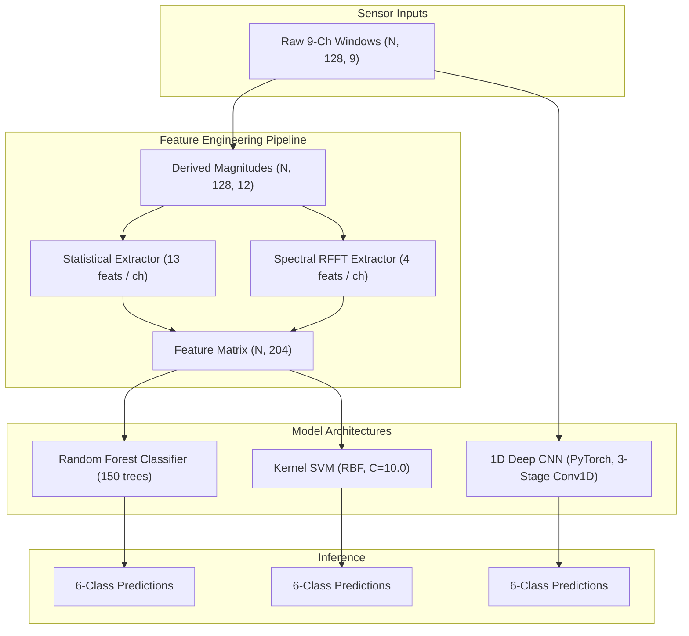

# Model Architectures Specification and Blueprint

**Project:** `imu-human-activity-recognition-ml`  
**Phase:** Day 2 – Model Development and Evaluation  
**Author:** Harish Narayanaan  

---

## 1. Overview of Evaluated Paradigms

This project benchmarks three distinct machine learning paradigms representing the spectrum of contemporary time-series kinematic analysis:

---

## 2. Model 1: Random Forest Classifier

### A. Architectural Details
- **Type:** Ensemble of bagging decision trees (`sklearn.ensemble.RandomForestClassifier`).
- **Feature Space:** 204 engineered statistical & frequency-domain features.
- **Hyperparameters:**
  - `n_estimators`: 150 trees.
  - `max_depth`: 25 levels (permits deep kinematic pattern segregation).
  - `min_samples_split`: 2.
  - `min_samples_leaf`: 1.
  - `max_features`: $\sqrt{p} = \sqrt{204} \approx 14$ features randomly subsampled per split.
  - `criterion`: Gini impurity.
  - `random_state`: 42.

### B. Computational Profile
- **Training Time:** 6.24 seconds (on 5,951 training samples).
- **Inference Latency:** **0.035 ms per 2.56-second window** (~28,500 windows/second).
- **Model Footprint:** 6.06 MB serialized joblib artifact.
- **Interpretability:** Built-in Mean Decrease in Impurity (MDI) feature ranking.

---

## 3. Model 2: Support Vector Machine (RBF Kernel)

### A. Architectural Details
- **Type:** Kernelized maximum-margin classifier (`sklearn.svm.SVC`) packaged in a `sklearn.pipeline.Pipeline`.
- **Feature Space:** 204 standardized features (fitted strictly on training fold).
- **Hyperparameters:**
  - `kernel`: Radial Basis Function (RBF) $K(x, x') = \exp(-\gamma \|x - x'\|^2)$.
  - `C`: 10.0 (regularization tradeoff parameter).
  - `gamma`: `'scale'` ($\gamma = \frac{1}{n_{\text{features}} \cdot \text{Var}(X)}$).
  - `decision_function_shape`: `'ovr'` (One-vs-Rest for 6 classes).
  - `random_state`: 42.

### B. Computational Profile
- **Training Time:** 2.92 seconds.
- **Inference Latency:** 0.266 ms per 2.56-second window (~3,750 windows/second).
- **Model Footprint:** 2.27 MB serialized artifact.
- **Mathematical Properties:** Convex optimization with guaranteed global minimum.

---

## 4. Model 3: 1D Deep Convolutional Neural Network (PyTorch)

### A. Architectural Details
- **Framework:** PyTorch (`torch.nn`).
- **Input Tensor:** Raw triaxial IMU windows `(batch_size, 9, 128)` where 9 is the number of sensor channels and 128 is the sequence length (50 Hz $\times$ 2.56 s).
- **Layer-by-Layer Topology:**

| Stage | Layer Type | Parameters / Configuration | Output Tensor Shape |
| :--- | :--- | :--- | :--- |
| **Input** | Raw Window Tensor | 9 channels, 128 timesteps | `(B, 9, 128)` |
| **Stage 1** | `Conv1d` | in=9, out=64, kernel=5, stride=1, pad=2 | `(B, 64, 128)` |
| | `BatchNorm1d` | 64 channels | `(B, 64, 128)` |
| | `ReLU` | In-place activation | `(B, 64, 128)` |
| | `MaxPool1d` | kernel=2, stride=2 | `(B, 64, 64)` |
| **Stage 2** | `Conv1d` | in=64, out=128, kernel=5, stride=1, pad=2 | `(B, 128, 64)` |
| | `BatchNorm1d` | 128 channels | `(B, 128, 64)` |
| | `ReLU` | In-place activation | `(B, 128, 64)` |
| | `MaxPool1d` | kernel=2, stride=2 | `(B, 128, 32)` |
| **Stage 3** | `Conv1d` | in=128, out=128, kernel=3, stride=1, pad=1 | `(B, 128, 32)` |
| | `BatchNorm1d` | 128 channels | `(B, 128, 32)` |
| | `ReLU` | In-place activation | `(B, 128, 32)` |
| **Aggregation**| `AdaptiveAvgPool1d` | Global Average Pooling (GAP) to 1 | `(B, 128)` |
| **Classifier** | `Dropout` | probability = 0.35 | `(B, 128)` |
| | `Linear` | in=128, out=64 | `(B, 64)` |
| | `ReLU` | In-place activation | `(B, 64)` |
| | `Dropout` | probability = 0.175 | `(B, 64)` |
| | `Linear` | in=64, out=6 (logits) | `(B, 6)` |

### B. Parameter Count
- Stage 1 Conv: $9 \times 64 \times 5 + 64 = 2,944$
- Stage 1 BN: $64 \times 2 = 128$
- Stage 2 Conv: $64 \times 128 \times 5 + 128 = 41,088$
- Stage 2 BN: $128 \times 2 = 256$
- Stage 3 Conv: $128 \times 128 \times 3 + 128 = 49,280$
- Stage 3 BN: $128 \times 2 = 256$
- Linear 1: $128 \times 64 + 64 = 8,256$
- Linear 2: $64 \times 6 + 6 = 390$
- **Total Trainable Parameters:** **102,598 parameters**

### C. Training Dynamics & Regularization
- **Loss Function:** `nn.CrossEntropyLoss()`
- **Optimizer:** AdamW ($\text{lr} = 0.001$, $\beta_1 = 0.9, \beta_2 = 0.999$, $\text{weight\_decay} = 10^{-4}$)
- **Learning Rate Scheduler:** `ReduceLROnPlateau(mode='min', factor=0.5, patience=3)`
- **Early Stopping:** Monitored on validation loss with patience of 8 epochs.
- **Model Footprint:** **0.40 MB** checkpoint file on disk.
- **Inference Latency:** 0.173 ms per window.
