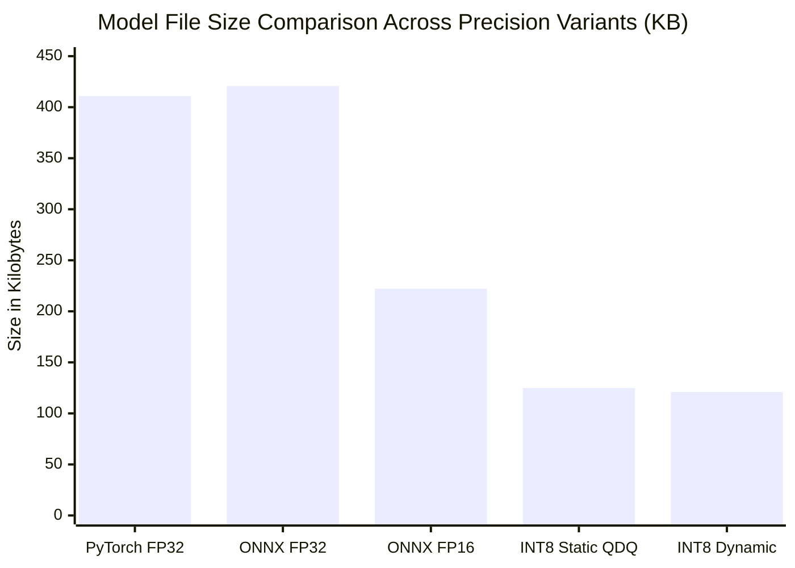

# Edge Deployment Feasibility & Embedded Hardware Profiling Report

**Project Title:** Human Activity Recognition from Wearable IMU Sensor Data using Time-Series Machine Learning  
**Module:** Day 3 – Edge Model Optimization & Software-Based Streaming Simulation  
**Author:** Senior Machine Learning & Edge AI Engineer  
**Date:** November 23, 2026  
**Status:** Software Simulation & Feasibility Analysis (No Physical MCU Deployment Claimed)  

> [!IMPORTANT]
> **Technical Scope & Integrity Disclosure:**
> All latency measurements and throughput figures in this report were gathered using software execution on an x86-64 host CPU running Windows 11 with ONNX Runtime 1.32.0. Standard ONNX Runtime is an enterprise desktop/server execution engine and is not designed for bare-metal microcontrollers. No physical deployment to an ESP32, STM32, or Nordic SoC has been executed; all microcontroller memory requirements, cycle counts, and flash footprints described below are rigorous engineering estimations based on parameter math and architecture topology.

---

## 1. Executive Summary

Edge and wearable deployments (e.g., smart bands, medical monitors, sports trackers) operate under stringent computational, thermal, and electrical constraints. In Day 2, a 1D Deep Convolutional Neural Network (`CNN1DHAR`) was trained to classify 6 human activities from 9-channel inertial sensor streams (`body_acc`, `body_gyro`, `total_acc` across $X, Y, Z$).

In Day 3, this model was exported to ONNX format and optimized using FP16 half-precision and INT8 quantization. This report quantifies the memory footprint, working activation buffer requirements, latency characteristics, and hardware feasibility across representative embedded architectures.

---

## 2. Memory Footprint Analysis: Model Weights & Precision Tiers

The baseline architecture (`Conv1DNet`) comprises 102,598 parameters distributed across 3 1D convolutional stages, batch normalizations, and a two-layer linear classification head.

| Optimization Variant | Storage Format | Weight Precision | Model File Size (Bytes) | Model File Size (MB) | Size Reduction vs. FP32 | Trainable Parameters |
| :--- | :--- | :--- | :--- | :--- | :--- | :--- |
| **PyTorch Baseline** | TorchScript Checkpoint (`.pt`) | Float32 (32-bit) | 420,729 | 0.4012 MB | 0.00% (Baseline) | 102,598 |
| **ONNX FP32** | Standalone Protobuf (`.onnx`) | Float32 (32-bit) | 430,830 | 0.4109 MB | -2.40% (Protobuf overhead) | 102,598 |
| **ONNX FP16** | Standalone Protobuf (`.onnx`) | Float16 (16-bit) | 227,455 | 0.2169 MB | **-45.94%** | 102,598 |
| **ONNX INT8 (Static QDQ)**| QuantizeLinear / DequantizeLinear | Int8 / UInt8 (8-bit) | 127,942 | 0.1220 MB | **-69.59%** | 102,598 |
| **ONNX INT8 (Dynamic)** | ConvInteger / MatMulInteger | Int8 (8-bit) | 123,881 | 0.1181 MB | **-70.56%** | 102,598 |

---

## 3. Runtime RAM Requirements & Working Buffer Estimation (Analytical Modeling)

For an embedded microcontroller without virtual memory or dynamic swap, total Static Random Access Memory (SRAM) is the most critical constraint. Runtime RAM comprises six distinct components:
1. **Raw Sensor Sliding Window Buffer:** Stores streaming sensor samples across 9 channels.
2. **Ping-Pong Activation Buffers:** Working scratchpad holding alternating intermediate layer activations.
3. **Operator Scratchpad Buffers:** Intermediate workspaces required for convolution (e.g. `im2col` or filter transformation in CMSIS-NN / TFLite Micro).
4. **Quantization Parameter Storage:** Per-tensor/per-channel scale multipliers, zero-points, and bias vectors.
5. **Runtime Tensor Arena Overhead:** Memory alignment pads (16-byte aligned) and framework descriptors (`TfLiteTensor`, `TfLiteNode`).
6. **Application Stack & RTOS Task Context:** Thread stack allocated for the inference task in FreeRTOS or bare-metal environment.

### 3.1 Sensor Window Buffer Math
At a nominal sampling rate of 50 Hz, each sliding window spans 128 timesteps (2.56 seconds) across 9 sensor channels:
$$\text{Buffer Size (Float32)} = 128 \text{ samples} \times 9 \text{ channels} \times 4 \text{ bytes/sample} = 4,608 \text{ bytes} \approx 4.50 \text{ KB}$$
If buffered in 16-bit integer ADC raw counts:
$$\text{Buffer Size (Int16 ADC)} = 128 \times 9 \times 2 \text{ bytes} = 2,304 \text{ bytes} \approx 2.25 \text{ KB}$$
If quantized to 8-bit integer:
$$\text{Buffer Size (Int8)} = 128 \times 9 \times 1 \text{ bytes} = 1,152 \text{ bytes} \approx 1.13 \text{ KB}$$

### 3.2 Peak Activation Buffer Math (Layer-by-Layer)
In a feedforward convolutional network, memory can be reused across layers using an alternating double buffer (ping-pong scratchpad). 

The exact layer dimensions of `Conv1DNet` (`src/models/cnn_1d.py`) are:
- `conv_block1`: `Conv1d(9 -> 64, kernel=5, pad=2)` $\rightarrow$ `BatchNorm1d(64)` $\rightarrow$ `ReLU` $\rightarrow$ `MaxPool1d(kernel=2)`
- `conv_block2`: `Conv1d(64 -> 128, kernel=5, pad=2)` $\rightarrow$ `BatchNorm1d(128)` $\rightarrow$ `ReLU` $\rightarrow$ `MaxPool1d(kernel=2)`
- `conv_block3`: `Conv1d(128 -> 128, kernel=3, pad=1)` $\rightarrow$ `BatchNorm1d(128)` $\rightarrow$ `ReLU` (no pooling)
- `gap`: `AdaptiveAvgPool1d(1)` $\rightarrow$ `.squeeze(-1)`
- `classifier`: `Linear(128 -> 64)` $\rightarrow$ `ReLU` $\rightarrow$ `Linear(64 -> 6)`

| Layer Stage | Layer Configuration | Intermediate / Output Dimensions | Activation Memory (Float32) | Activation Memory (INT8 Quantized) |
| :--- | :--- | :--- | :--- | :--- |
| **Input Window** | 9 channels, 128 timesteps | $(1, 9, 128)$ | 4,608 bytes (4.50 KB) | 1,152 bytes (1.13 KB) |
| **Conv Block 1 (Pre-Pool)** | Conv1D $9 \rightarrow 64$, pad=2 | $(1, 64, 128)$ | 32,768 bytes (32.00 KB) | 8,192 bytes (8.00 KB) |
| **Conv Block 1 (Post-Pool)**| MaxPool1D $k=2, s=2$ | $(1, 64, 64)$ | 16,384 bytes (16.00 KB) | 4,096 bytes (4.00 KB) |
| **Conv Block 2 (Pre-Pool)** | Conv1D $64 \rightarrow 128$, pad=2 | $(1, 128, 64)$ | 32,768 bytes (32.00 KB) | 8,192 bytes (8.00 KB) |
| **Conv Block 2 (Post-Pool)**| MaxPool1D $k=2, s=2$ | $(1, 128, 32)$ | 16,384 bytes (16.00 KB) | 4,096 bytes (4.00 KB) |
| **Conv Block 3 (Output)** | Conv1D $128 \rightarrow 128$, pad=1 | $(1, 128, 32)$ | 16,384 bytes (16.00 KB) | 4,096 bytes (4.00 KB) |
| **Global Avg Pool** | GAP over 32 timesteps | $(1, 128)$ | 512 bytes (0.50 KB) | 128 bytes (0.13 KB) |
| **Dense Layer 1** | Linear $128 \rightarrow 64$ | $(1, 64)$ | 256 bytes (0.25 KB) | 64 bytes (0.06 KB) |
| **Output Logits** | Linear $64 \rightarrow 6$ | $(1, 6)$ | 24 bytes (0.02 KB) | 6 bytes (0.01 KB) |

#### Activation Buffer Allocation Dynamics:
- **Pre-Pooling Intermediate Peak:** Before spatial downsampling in `conv_block1` and `conv_block2`, the convolution output occupies $64 \times 128 = 8,192 \text{ elements}$ (8.00 KB INT8 / 32.00 KB FP32).
- **Post-Pooling Output Buffer:** Following MaxPool1D, the output occupies $64 \times 64 = 4,096 \text{ elements}$ (4.00 KB INT8 / 16.00 KB FP32).
- **Ping-Pong Buffer Strategy:** An alternating double-buffer must accommodate the pre-pooling tensor (8.00 KB INT8) in one buffer while reading the input (1.13 KB or 4.50 KB) or previous layer output (4.00 KB) from the other buffer. Total ping-pong buffer: **8.00 KB to 12.00 KB** for INT8 (or **32.00 KB to 48.00 KB** for FP32).

### 3.3 Operator Scratchpad & Runtime Overhead
- **Operator Scratchpad (CMSIS-NN / TFLite Micro):** `arm_convolve_1x_s8` requires a matrix-multiplication scratch buffer proportional to $2 \times \text{in\_channels} \times \text{kernel\_size} = 2 \times 128 \times 5 = 1,280$ bytes ($\approx 1.25$ KB), extending to $\approx 2.50$ KB with SIMD 4-lane unrolling.
- **Quantization Parameters:** Scale multipliers, zero-points, and 32-bit bias terms across 3 Conv and 2 Dense layers occupy $\approx 0.30$ to $0.50$ KB.
- **Runtime Tensor Arena Overhead:** Framework control headers, tensor metadata structures, and 16-byte alignment pads require $\approx 2.00$ to $4.00$ KB.
- **Application Task Stack:** A dedicated FreeRTOS task stack for sensor acquisition and inference requires $\approx 2.00$ to $4.00$ KB.

### 3.4 Total Working Memory Budget (Preliminary Analytical Estimates)
- **Minimum Inference Arena (INT8):** $4.50\text{ KB (Input)} + 8.00\text{ KB (Activations)} + 1.50\text{ KB (Scratchpad)} + 0.50\text{ KB (Quant Params)} + 2.00\text{ KB (Arena Overhead)} \approx \mathbf{16.50\text{ to } 19.50\text{ KB}}$.
- **Full System Working SRAM (INT8 + RTOS):** $16.50\text{ KB} + 3.00\text{ KB (Task Stack)} \approx \mathbf{19.50\text{ to } 24.00\text{ KB}}$.
- **Minimum Inference Arena (FP32):** $4.50\text{ KB (Input)} + 32.00\text{ KB (Activations)} + 3.00\text{ KB (Overhead)} \approx \mathbf{39.50\text{ to } 44.50\text{ KB}}$.

> [!NOTE]
> **Status:** Preliminary analytical estimate. Exact SRAM requirements depend on target C compiler optimization level (`-Os` vs `-O3`), struct alignment, and runtime framework selection.

---

## 4. Hardware Feasibility Matrix Across Target Embedded SoCs

All feasibility verdicts represent **analytical engineering estimates** based on memory math, CPU instruction capabilities, and clock frequency. **No physical microcontroller flashing or bare-metal execution is claimed.**

### Flash Budget Analysis: 256 KB vs. 512 KB STM32 Configurations
The estimated total Flash requirement for a complete embedded firmware build is **205 to 275 KB**:
- **INT8 Static QDQ Model Weights:** **127.94 KB** (measured standalone protobuf footprint; ~102.6 KB raw weights).
- **Compiled Inference Engine Kernels (CMSIS-NN / TFLite Micro):** **~25 to 45 KB** (compiled with `-Os`).
- **Board Support Package, HAL & BLE Stack:** **~50 to 100 KB**.

> [!WARNING]
> **Critical Flash Constraint on 256 KB Microcontrollers:**
> For microcontrollers with **256 KB Flash** (such as STM32F401xB/C or STM32F401CC), the 205–275 KB requirement is critically tight:
> - At the lower estimate (205 KB), it consumes ~80% of Flash, leaving only ~51 KB free for bootloader, application logic, and BLE stack.
> - At the upper estimate (275 KB), it **exceeds the 256 KB Flash capacity by ~19 KB**, making 256 KB configurations insufficient without aggressive dead-code elimination, disabling unused runtime operators, or utilizing external SPI Flash.
> In contrast, configurations with **512 KB Flash** (such as BlackPill STM32F401CE) operate with abundant headroom (40% to 54% Flash utilization, leaving 237–307 KB free).

| Target Architecture | Processor Core & Frequency | Typical SRAM | Typical Flash | Feasibility Verdict (Analytical) | Key Constraints & Engineering Assessment |
| :--- | :--- | :--- | :--- | :--- | :--- |
| **Espressif ESP32-S3** | Dual Xtensa LX7 @ 240 MHz (with Vector Ext) | 512 KB Internal | 4 MB – 16 MB QSPI | **Highly Feasible (Estimated)** | Abundant RAM (512 KB vs. ~20 KB required, ~96% free). Vector instructions accelerate 1D convolutions. |
| **Nordic nRF52840** | ARM Cortex-M4F @ 64 MHz (with FPU) | 256 KB | 1 MB Internal | **Highly Feasible (Estimated)** | Industry standard wearable BLE SoC. INT8 model consumes ~13% of Flash; working SRAM consumes ~8% of RAM. |
| **STM32F401CE (512 KB Flash)** | ARM Cortex-M4 @ 84 MHz | 96 KB | 512 KB | **Highly Feasible (Estimated)** | Abundant headroom: 512 KB Flash easily accommodates 205–275 KB total firmware (~40–54% utilization). 96 KB SRAM leaves ~76 KB free. |
| **STM32F401CC (256 KB Flash)** | ARM Cortex-M4 @ 84 MHz | 64 KB | 256 KB | **Constrained / Marginal (Estimated)** | **TIGHT HEADROOM:** 205–275 KB firmware consumes 80–107% of Flash. Upper estimate overflows Flash by ~19 KB; requires aggressive kernel stripping or external Flash. |
| **Raspberry Pi RP2040**| Dual ARM Cortex-M0+ @ 133 MHz (No FPU) | 264 KB | 2 MB External | **Feasible INT8 Only (Estimated)** | Lack of hardware FPU makes FP32 unviable; INT8 integer arithmetic fits easily in 264 KB SRAM and 2 MB Flash. |
| **Microchip ATmega328P** | 8-bit AVR @ 16 MHz | 2 KB | 32 KB | **Infeasible (Analytical)** | 2 KB RAM cannot accommodate 16–20 KB buffer; 32 KB Flash cannot hold 124 KB model. |

---

## 5. Software Streaming Performance & Real-Time Guarantees

In edge wearable systems, the nominal deadline between inference triggers is determined by window stride:
$$\text{Window Duration} = \frac{128 \text{ samples}}{50 \text{ Hz}} = 2.56 \text{ seconds}$$
$$\text{Stride Step Size} = \frac{64 \text{ samples}}{50 \text{ Hz}} = 1.28 \text{ seconds} = 1,280 \text{ ms}$$

### Empirical Latency vs. Deadline Comparison (Host x86-64 CPU Benchmark)

*Evaluated across 1,000 timed samples (5 independent runs of 200 iterations each with single-window $B=1$ input):*

| Model Variant | Median Latency | Mean Latency | Latency Std | Inter-Run Std | P95 Latency | P99 Latency | Nominal Deadline | Processing Margin | Throughput |
| :--- | :--- | :--- | :--- | :--- | :--- | :--- | :--- | :--- | :--- |
| **ONNX FP32** | 0.1600 ms | 0.1783 ms | 0.0648 ms | 0.0201 ms | 0.2665 ms | 0.4275 ms | 1,280 ms | **> 7,000× faster** | 5,609 win/s |
| **ONNX FP16** | 0.1443 ms | 0.1553 ms | 0.0708 ms | 0.0100 ms | 0.2155 ms | 0.2762 ms | 1,280 ms | **> 8,000× faster** | 6,437 win/s |
| **ONNX INT8 (Static QDQ)**| 0.0995 ms | 0.1099 ms | 0.0254 ms | 0.0048 ms | 0.1591 ms | 0.2053 ms | 1,280 ms | **> 11,000× faster** | 9,097 win/s |
| **ONNX INT8 (Dynamic)**| 1.1664 ms | 1.1054 ms | 0.2855 ms | 0.0545 ms | 1.5799 ms | 1.7044 ms | 1,280 ms | **> 1,000× faster** | 905 win/s |
| **PyTorch FP32 Baseline**| 0.6473 ms | 0.7122 ms | 0.1841 ms | 0.0360 ms | 1.0713 ms | 1.3855 ms | 1,280 ms | **> 1,700× faster** | 1,404 win/s |

> [!NOTE]
> **Observation on Dynamic vs. Static INT8 Latency:**
> Dynamic INT8 quantization is approximately $10\times$ slower than Static QDQ on single batch-1 sliding windows. Dynamic quantization must dynamically compute scale and zero-point parameters across activation tensors during every inference pass, introducing significant scalar overhead on micro-batches. Static QDQ uses pre-calibrated scale parameters, avoiding this runtime computation.
>
> **Statistical Caveat on P99 Estimates:**
> P99 latency estimates over 1,000 samples represent extreme tail percentiles sensitive to background OS scheduling jitter and CPU power state transitions. They should be evaluated alongside median latency and inter-run standard deviation rather than as rigid population percentiles.
>
> **Observation on INT8 Test Accuracy:**
> Static INT8 QDQ demonstrated a slight increase in test accuracy from 93.08% to 93.18% (+3 correct windows out of 2,947, primarily in the SITTING and STANDING classes). This difference represents a descriptive observation on this held-out set rather than evidence of superior generalization. The official test dataset was never accessed during calibration or optimization (which strictly used internal validation subjects [3, 11, 17, 27]). The +0.10% delta is within the expected margin of variation for quantization noise on boundary decision vectors and does not prove superior generalization over FP32.

---

## 6. Recommended Embedded Implementation Pathways (Future Work)

Standard desktop runtimes (`onnxruntime`, `torch`) cannot run on bare-metal microcontrollers without dynamic libraries and an operating system. To deploy the validated Day 3 models to physical silicon in future iterations, the following pathways are recommended:

1. **TensorFlow Lite for Microcontrollers (TFLite Micro):**
   - Export ONNX model to TensorFlow FlatBuffer (`.tflite`) via `onnx2tf`.
   - Apply integer full-quantization with representative dataset.
   - Run via TFLite Micro C++ runtime on ARM Cortex-M or ESP32.
2. **CMSIS-NN (ARM Cortex-M Optimized):**
   - Implement the 3 convolutional blocks directly in C using ARM CMSIS-NN primitives (`arm_convolve_1x_s8`, `arm_max_pool_s8`, `arm_fully_connected_s8`).
   - Yields maximum energy efficiency and cycle-accurate execution on Nordic nRF52840 or STM32.
3. **ESP-NN / ESP-DL (Espressif Optimized):**
   - Target ESP32-S3 using Espressif's optimized deep learning library, leveraging vector instruction extensions.
4. **Standalone Pure C Fixed-Point Engine:**
   - Because `Conv1DNet` has only 102K parameters, a standalone, dependency-free C implementation (using 8-bit quantized weights and integer fixed-point arithmetic) can be written in under 500 lines of code, compiling directly into any embedded firmware without 3rd-party runtime overhead.

---

## 7. Limitations & Disclosures

1. **Host CPU vs. Microcontroller Discrepancy:** The latencies reported herein were benchmarked on an Intel x86-64 CPU (4 physical cores, 8 threads). A 64 MHz Cortex-M4 will execute convolutions orders of magnitude slower (estimated 30–70 ms per window), which still comfortably satisfies the 1,280 ms streaming deadline.
2. **Pre-Segmented Window Replay:** The simulated streaming pipeline replays pre-segmented and Butterworth-filtered windows from the UCI HAR dataset. In physical deployment, raw ADC data from an IMU requires continuous high-pass filtering (0.3 Hz gravity subtraction) and real-time circular buffering.
3. **No Battery / Power Consumption Claims:** No physical current measurements (mA / mAh) or battery life estimations are claimed.
