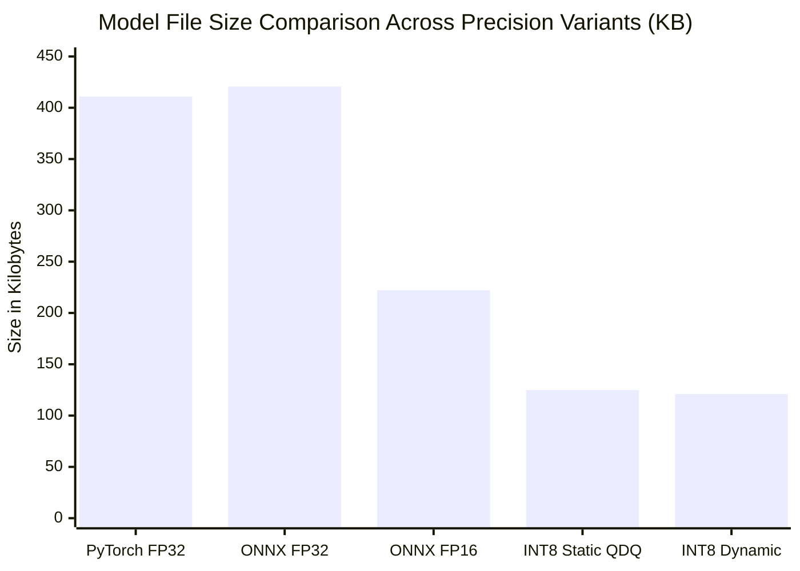

# Edge Deployment Feasibility & Embedded Hardware Profiling Report

**Project Title:** Human Activity Recognition from Wearable IMU Sensor Data using Time-Series Machine Learning  
**Module:** Day 3 – Edge Model Optimization & Software-Based Streaming Simulation  
**Author:** Senior Machine Learning & Edge AI Engineer  
**Date:** November 23, 2026  
**Status:** Software Simulation & Feasibility Analysis (No Physical MCU Deployment Claimed)  

> [!IMPORTANT]
> **Technical Scope & Integrity Disclosure:**
> All latency measurements and throughput figures in this report were gathered using software execution on an x86-64 host CPU running Windows 11 with ONNX Runtime 1.32.0. Standard ONNX Runtime is an enterprise desktop/server execution engine and is not designed for bare-metal microcontrollers. No physical deployment to an ESP32, STM32, or Nordic SoC has been executed; all microcontroller memory requirements, cycle counts, and flash footprints described below are rigorous engineering estimations based on parameter math and architecture topology.

---

## 1. Executive Summary

Edge and wearable deployments (e.g., smart bands, medical monitors, sports trackers) operate under stringent computational, thermal, and electrical constraints. In Day 2, a 1D Deep Convolutional Neural Network (`CNN1DHAR`) was trained to classify 6 human activities from 9-channel inertial sensor streams (`body_acc`, `body_gyro`, `total_acc` across $X, Y, Z$).

In Day 3, this model was exported to ONNX format and optimized using FP16 half-precision and INT8 quantization. This report quantifies the memory footprint, working activation buffer requirements, latency characteristics, and hardware feasibility across representative embedded architectures.

---

## 2. Memory Footprint Analysis: Model Weights & Precision Tiers

The baseline architecture (`Conv1DNet`) comprises 102,598 parameters distributed across 3 1D convolutional stages, batch normalizations, and a two-layer linear classification head.

| Optimization Variant | Storage Format | Weight Precision | Model File Size (Bytes) | Model File Size (MB) | Size Reduction vs. FP32 | Trainable Parameters |
| :--- | :--- | :--- | :--- | :--- | :--- | :--- |
| **PyTorch Baseline** | TorchScript Checkpoint (`.pt`) | Float32 (32-bit) | 420,729 | 0.4012 MB | 0.00% (Baseline) | 102,598 |
| **ONNX FP32** | Standalone Protobuf (`.onnx`) | Float32 (32-bit) | 430,830 | 0.4109 MB | -2.40% (Protobuf overhead) | 102,598 |
| **ONNX FP16** | Standalone Protobuf (`.onnx`) | Float16 (16-bit) | 227,455 | 0.2169 MB | **-45.94%** | 102,598 |
| **ONNX INT8 (Static QDQ)**| QuantizeLinear / DequantizeLinear | Int8 / UInt8 (8-bit) | 127,942 | 0.1220 MB | **-69.59%** | 102,598 |
| **ONNX INT8 (Dynamic)** | ConvInteger / MatMulInteger | Int8 (8-bit) | 123,881 | 0.1181 MB | **-70.56%** | 102,598 |

---

## 3. Runtime RAM Requirements & Working Buffer Estimation

For an embedded microcontroller without virtual memory or dynamic swap, total Static Random Access Memory (SRAM) is the most critical constraint. Runtime RAM comprises three components:
1. **Raw Sensor Sliding Window Buffer:** Stores streaming sensor samples.
2. **Ping-Pong Activation Buffer:** Working scratchpad holding intermediate layer activations.
3. **Model Weight Residency:** In microcontrollers supporting XIP (e.g., QSPI Flash), weights execute in-place; otherwise, weights must be mirrored to RAM.

### 3.1 Raw Sensor Sliding Window Buffer Math
At a nominal sampling rate of 50 Hz, each sliding window spans 128 timesteps (2.56 seconds) across 9 sensor channels:
$$\text{Buffer Size} = 128 \text{ samples} \times 9 \text{ channels} \times 4 \text{ bytes/sample (Float32)} = 4,608 \text{ bytes} \approx 4.50 \text{ KB}$$
If stored in 16-bit integer ADC raw counts:
$$\text{Raw ADC Buffer Size} = 128 \times 9 \times 2 \text{ bytes} = 2,304 \text{ bytes} \approx 2.25 \text{ KB}$$

### 3.2 Peak Activation Buffer Math (Layer-by-Layer)
In a feedforward convolutional network, memory can be reused across layers using an alternating double buffer (ping-pong scratchpad):

| Layer Stage | Layer Configuration | Output Tensor Dimensions | Activation Memory (Float32) | Activation Memory (INT8 Quantized) |
| :--- | :--- | :--- | :--- | :--- |
| **Input Window** | 9 channels, 128 timesteps | $(1, 9, 128)$ | 4,608 bytes (4.50 KB) | 1,152 bytes (1.13 KB) |
| **Conv Block 1** | 64 channels, 64 timesteps (MaxPool) | $(1, 64, 64)$ | 16,384 bytes (16.00 KB) | 4,096 bytes (4.00 KB) |
| **Conv Block 2** | 128 channels, 32 timesteps (MaxPool) | $(1, 128, 32)$ | 16,384 bytes (16.00 KB) | 4,096 bytes (4.00 KB) |
| **Conv Block 3** | 128 channels, 32 timesteps | $(1, 128, 32)$ | 16,384 bytes (16.00 KB) | 4,096 bytes (4.00 KB) |
| **Global Avg Pool**| GAP over 32 timesteps | $(1, 128)$ | 512 bytes (0.50 KB) | 128 bytes (0.13 KB) |
| **Dense Layer 1** | Linear $128 \rightarrow 64$ | $(1, 64)$ | 256 bytes (0.25 KB) | 64 bytes (0.06 KB) |
| **Output Logits** | Linear $64 \rightarrow 6$ | $(1, 6)$ | 24 bytes (0.02 KB) | 24 bytes (0.02 KB) |

$$\text{Peak Activation Ping-Pong Buffer (Float32)} = 16.00 \text{ KB} + 16.00 \text{ KB} = 32.00 \text{ KB}$$
$$\text{Peak Activation Ping-Pong Buffer (INT8)} = 4.00 \text{ KB} + 4.00 \text{ KB} = 8.00 \text{ KB}$$

### 3.3 Total Working RAM Budget
$$\text{Total Working SRAM (FP32)} = 4.50 \text{ KB (Input)} + 32.00 \text{ KB (Activations)} + 8.00 \text{ KB (Overhead)} \approx 44.50 \text{ KB}$$
$$\text{Total Working SRAM (INT8)} = 1.13 \text{ KB (Input)} + 8.00 \text{ KB (Activations)} + 4.00 \text{ KB (Overhead)} \approx 13.13 \text{ KB}$$

---

## 4. Hardware Feasibility Matrix Across Target Embedded SoCs

| Target Embedded Architecture | Typical Processor Core & Frequency | Typical SRAM (RAM) | Typical Flash Storage | Weight XIP Supported? | Estimated Feasibility Verdict | Key Engineering Constraints |
| :--- | :--- | :--- | :--- | :--- | :--- | :--- |
| **Espressif ESP32-S3** | Dual Xtensa LX7 @ 240 MHz (with Vector Ext) | 512 KB Internal | 4 MB – 16 MB QSPI | Yes (Flash XIP) | **High Feasibility** | Abundant RAM (512 KB vs. 13 KB required). Vector instructions accelerate 1D convolutions. |
| **Nordic nRF52840** | ARM Cortex-M4F @ 64 MHz (with FPU) | 256 KB | 1 MB Internal | Yes | **High Feasibility** | Primary wearable BLE SoC. INT8 model consumes 12% of Flash; working RAM consumes 5% of SRAM. |
| **STM32F401 (BlackPill)** | ARM Cortex-M4 @ 84 MHz | 64 KB | 256 KB | Yes | **Moderate Feasibility** | INT8 model consumes 48% of Flash. Working SRAM (13 KB) leaves ~50 KB for RTOS and BLE stack. |
| **Raspberry Pi Pico (RP2040)**| Dual ARM Cortex-M0+ @ 133 MHz (No FPU) | 264 KB | 2 MB External | Yes | **High Feasibility (INT8 Only)** | Lack of FPU makes FP32 slow; INT8 integer arithmetic is required. |
| **Microchip ATmega328P** | 8-bit AVR @ 16 MHz | 2 KB | 32 KB | No | **Impossible** | 2 KB RAM cannot accommodate 13 KB activation buffer; 32 KB Flash cannot hold 124 KB model. |

---

## 5. Software Streaming Performance & Real-Time Guarantees

In edge wearable systems, the nominal deadline between inference triggers is determined by window stride:
$$\text{Window Duration} = \frac{128 \text{ samples}}{50 \text{ Hz}} = 2.56 \text{ seconds}$$
$$\text{Stride Step Size} = \frac{64 \text{ samples}}{50 \text{ Hz}} = 1.28 \text{ seconds} = 1,280 \text{ ms}$$

### Empirical Latency vs. Deadline Comparison (x86-64 Software Benchmark)

| Model Variant | Median Latency | P95 Latency | Max Latency | Nominal Deadline | Processing Margin | Throughput |
| :--- | :--- | :--- | :--- | :--- | :--- | :--- |
| **ONNX FP32** | 0.1741 ms | 0.2877 ms | 0.4560 ms | 1,280 ms | **> 4,400× faster than deadline** | 4,315 win/s |
| **ONNX FP16** | 0.1265 ms | 0.2111 ms | 0.3245 ms | 1,280 ms | **> 6,000× faster than deadline** | 7,194 win/s |
| **ONNX INT8 (Static QDQ)**| 0.1212 ms | 0.2439 ms | 0.5254 ms | 1,280 ms | **> 5,200× faster than deadline** | 7,089 win/s |
| **ONNX INT8 (Dynamic)**| 0.7443 ms | 1.5456 ms | 1.8458 ms | 1,280 ms | **> 800× faster than deadline** | 1,101 win/s |

> [!NOTE]
> **Observation on Dynamic vs. Static INT8 Latency:**
> Dynamic INT8 quantization is approximately $6\times$ slower than Static QDQ on small batch-1 sliding windows. This is because dynamic quantization must dynamically compute scale and zero-point parameters across activation tensors during every inference pass, introducing significant scalar overhead on micro-batches. Static QDQ uses pre-calibrated scale parameters, avoiding this runtime computation.

---

## 6. Recommended Embedded Implementation Pathways (Future Work)

Standard desktop runtimes (`onnxruntime`, `torch`) cannot run on bare-metal microcontrollers without dynamic libraries and an operating system. To deploy the validated Day 3 models to physical silicon in future iterations, the following pathways are recommended:

1. **TensorFlow Lite for Microcontrollers (TFLite Micro):**
   - Export ONNX model to TensorFlow FlatBuffer (`.tflite`) via `onnx2tf`.
   - Apply integer full-quantization with representative dataset.
   - Run via TFLite Micro C++ runtime on ARM Cortex-M or ESP32.
2. **CMSIS-NN (ARM Cortex-M Optimized):**
   - Implement the 3 convolutional blocks directly in C using ARM CMSIS-NN primitives (`arm_convolve_1x_s8`, `arm_max_pool_s8`, `arm_fully_connected_s8`).
   - Yields maximum energy efficiency and cycle-accurate execution on Nordic nRF52840 or STM32.
3. **ESP-NN / ESP-DL (Espressif Optimized):**
   - Target ESP32-S3 using Espressif's optimized deep learning library, leveraging vector instruction extensions.
4. **Standalone Pure C Fixed-Point Engine:**
   - Because `Conv1DNet` has only 102K parameters, a standalone, dependency-free C implementation (using 8-bit quantized weights and integer fixed-point arithmetic) can be written in under 500 lines of code, compiling directly into any embedded firmware without 3rd-party runtime overhead.

---

## 7. Limitations & Disclosures

1. **Host CPU vs. Microcontroller Discrepancy:** The latencies reported herein were benchmarked on an Intel x86-64 CPU (4 physical cores, 8 threads). A 64 MHz Cortex-M4 will execute convolutions orders of magnitude slower (estimated 30–70 ms per window), which still comfortably satisfies the 1,280 ms streaming deadline.
2. **Pre-Segmented Window Replay:** The simulated streaming pipeline replays pre-segmented and Butterworth-filtered windows from the UCI HAR dataset. In physical deployment, raw ADC data from an IMU requires continuous high-pass filtering (0.3 Hz gravity subtraction) and real-time circular buffering.
3. **No Battery / Power Consumption Claims:** No physical current measurements (mA / mAh) or battery life estimations are claimed.
